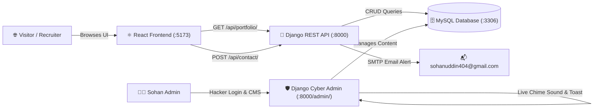

# ⚡ Sohan's Full-Stack Dynamic Developer Portfolio

[](https://www.djangoproject.com/)
[](https://reactjs.org/)
[](https://vitejs.dev/)
[](https://tailwindcss.com/)
[](https://www.mysql.com/)
[](https://www.python.org/)

একটি অত্যন্ত আকর্ষণীয়, আধুনিক ও পূর্ণাঙ্গ **Dynamic Portfolio Web Application**। এটি তৈরি করা হয়েছে **Python Django (Backend)**, **MySQL (Database)** এবং **React.js + Tailwind CSS (Frontend)** দিয়ে। 

ওয়েবসাইটটির ভিজ্যুয়াল ডিজাইন করা হয়েছে প্রিমিয়াম **Electric Blue, Cyan & Emerald Glow** (Cyberpunk/Futuristic Glassmorphism) থিমে। ব্যাকএন্ড (Django Admin) থেকে ওয়েবসাইটের **A to Z সবকিছু ১০০% ডাইনামিকভাবে পরিবর্তন ও নিয়ন্ত্রণ করা যায়** (প্রোফাইল, ছবি, সিভি, স্কিল, সার্ভিস, প্রজেক্ট, অভিজ্ঞতা ও ক্লায়েন্ট মেসেজ)।

---

## ✨ প্রধান বৈশিষ্ট্যসমূহ (Key Features)

- 🎨 **Electric Blue, Cyan & Emerald Palette**: মসৃণ গ্লাস-মরফিজম (Glassmorphism), টেক্সট গ্রেডিয়েন্ট ও ডাইনামিক লাইট এফেক্ট।
- 🧑‍💻 **কাস্টম সাইবার হ্যাকার অ্যাডমিন থিম**:
  - Django Admin Login পেজে ইন্টারেক্টিভ **Matrix Digital Rain Canvas Animation**।
  - অ্যাডমিন ড্যাশবোর্ডে মডার্ন **রেক্ট্যাঙ্গুলার কার্ড গ্রিড (Rectangle Card Grid)** ডিজাইন।
- 🔔 **রিয়েল-টাইম অডিও ও ভিজ্যুয়াল নোটিফিকেশন**:
  - ফ্রন্টএন্ড থেকে কোনো ভিজিটর মেসেজ পাঠালে Django Admin-এ স্বয়ংক্রিয়ভাবে **Web Audio API Synth Chime Sound** বেজে উঠবে।
  - স্ক্রিনের উপরে ভেসে উঠবে **Floating Cyber Alert Toast**।
- 📧 **অটোমেটিক ইমেইল ডিসপ্যাচ**: ভিজিটরের মেসেজ সাথে সাথে অ্যাডমিনের ইমেইলে (`sohanuddin404@gmail.com`) ফরোয়ার্ড করার ইন্টিগ্রেশন (সাপোর্টস Gmail App Password ও কনসোল ব্যাকআপ)।
- ⚡ **RESTful API আর্কিটেকচার**: Django REST Framework (DRF) দিয়ে সুপারফাস্ট ডাটা লোডিং ও ক্যাশিং।
- 📱 **সম্পূর্ণ রেসপন্সিভ**: মোবাইল, ট্যাবলেট ও বড় মনিটরে নিখুঁত প্রদর্শন।
- 🛡️ **সুরক্ষিত ও ফলব্যাক রেডি**: ব্যাকএন্ড সাময়িকভাবে অফলাইন থাকলেও ফ্রন্টএন্ড ক্র্যাশ করবে না; অফলাইন ফলব্যাক ডাটা স্বয়ংক্রিয়ভাবে প্রদর্শিত হবে।

---

## 🏗️ সিস্টেম আর্কিটেকচার (System Architecture)



---

## 🗄️ ডাটাবেজ কনফিগারেশন (MySQL)

প্রজেক্টটি **MySQL** ডাটাবেজের সাথে সরাসরি কানেক্টেড:
- **Database Engine**: MySQL (`django.db.backends.mysql` via `PyMySQL`)
- **Database Name**: `sohan_portfolio_db`
- **Host**: `127.0.0.1` (localhost)
- **Port**: `3306`
- **User**: `root`
- **Password**: *(ফাঁকা / Default XAMPP)*

---

## 🚀 লোকাল সেটআপ গাইড (Installation & Setup)

### ১. রিপোজিটরি ক্লোন করুন
```bash
git clone https://github.com/ImranNajirSohan/sohan-portfolio.git
cd sohan-portfolio
```

### ২. ডাটাবেজ তৈরি করুন
আপনার MySQL সার্ভার (XAMPP / MySQL Workbench / Terminal) চালু করুন এবং ডাটাবেজটি তৈরি করুন:
```sql
CREATE DATABASE sohan_portfolio_db CHARACTER SET utf8mb4 COLLATE utf8mb4_unicode_ci;
```

### ৩. ব্যাকএন্ড সেটআপ (Django)
```bash
cd backend

# ভার্চুয়াল এনভায়রনমেন্ট তৈরি ও একটিভ করুন
python -m venv venv
# Windows:
.\venv\Scripts\activate
# Linux/Mac:
source venv/bin/activate

# ডিপেনডেন্সি ইন্সটল করুন
pip install -r requirements.txt

# এনভায়রনমেন্ট কনফিগার করুন
copy .env.example .env

# ডাটাবেজ মাইগ্রেশন ও প্রাথমিক ডাটা লোড করুন
python manage.py migrate
python seed_data.py

# অ্যাডমিন ইউজার তৈরি করুন (ঐচ্ছিক)
python manage.py createsuperuser

# ব্যাকএন্ড সার্ভার চালু করুন
python manage.py runserver 127.0.0.1:8000
```

### ৪. ফ্রন্টএন্ড সেটআপ (React + Vite)
আলাদা একটি টার্মিনালে:
```bash
cd frontend

# ডিপেনডেন্সি ইন্সটল করুন
npm install

# ডেভেলপমেন্ট সার্ভার চালু করুন
npm run dev
```

### ৫. এক ক্লিকে চালুর শর্টকাট (Windows)
Windows ব্যবহারকারীদের জন্য রুট ডিরেক্টরিতে অটোমেশন স্ক্রিপ্ট তৈরি আছে:
- **`start_all.bat`** ফাইলে ডাবল-ক্লিক করলেই ব্যাকএন্ড ও ফ্রন্টএন্ড দুটিই আলাদা কমান্ড উইন্ডোতে স্বয়ংক্রিয়ভাবে রান হয়ে যাবে।

---

## 🌐 সার্ভিস ইউআরএল ও পোর্ট (Local Endpoints)

| কম্পোনেন্ট | ইউআরএল | বিবরণ |
|---|---|---|
| **Frontend UI** | [http://localhost:5173](http://localhost:5173) | মূল পোর্টফোলিও ওয়েবসাইট |
| **Backend API** | [http://127.0.0.1:8000/api/portfolio/](http://127.0.0.1:8000/api/portfolio/) | ফুল পোর্টফোলিও JSON API |
| **Contact API** | [http://127.0.0.1:8000/api/contact/](http://127.0.0.1:8000/api/contact/) | মেসেজ পাঠানোর এন্ডপয়েন্ট |
| **Cyber Admin Portal** | [http://127.0.0.1:8000/admin/](http://127.0.0.1:8000/admin/) | কনটেন্ট ম্যানেজমেন্ট ড্যাশবোর্ড |

---

## 🔐 অ্যাডমিন লগইন (Default Credentials)

- **Login URL**: [http://127.0.0.1:8000/admin/](http://127.0.0.1:8000/admin/)
- **Username**: `admin`
- **Password**: `admin123`
*(প্রোডাকশনে ডেপ্লয় করার সময় অবশ্যই পাসওয়ার্ড পরিবর্তন করুন)*

---

## 📁 প্রজেক্ট স্ট্রাকচার (Project Structure)

```
sohan/
├── backend/                        # Django Backend Project
│   ├── api/                        # Portfolio Core API App
│   │   ├── models.py               # ডাটাবেজ মডেল (Profile, Skill, Project, Message, etc.)
│   │   ├── serializers.py          # Django REST Serializers
│   │   ├── views.py                # API হ্যান্ডলার ও ইমেইল লজিক
│   │   ├── urls.py                 # API এন্ডপয়েন্ট রাউটস
│   │   └── admin.py                # অ্যাডমিন কাস্টমাইজেশন ও সার্চ ফিল্টার
│   ├── portfolio_backend/          # মূল সেটিংস (settings.py, urls.py, wsgi.py)
│   ├── templates/admin/            # কাস্টম হ্যাকার লগইন ও নোটিফিকেশন টেমপ্লেট
│   ├── static/                     # স্ট্যাটিক CSS ও আইকন
│   ├── media/                      # আপলোড করা ছবি ও Resume PDF
│   ├── seed_data.py                # ডিফল্ট ডাটা সিডার স্ক্রিপ্ট
│   ├── requirements.txt            # পাইথন প্যাকেজ তালিকা
│   ├── .env.example                # এনভায়রনমেন্ট ভ্যারিয়েবল টেমপ্লেট
│   └── manage.py
├── frontend/                       # React.js Frontend Project
│   ├── src/
│   │   ├── components/             # মডুলার ইউআই কম্পোনেন্টস
│   │   │   ├── Navbar.jsx          # হেডার ও মেনু
│   │   │   ├── Hero.jsx            # হিরো সেকশন ও টাইপরাইটার অ্যানিমেশন
│   │   │   ├── About.jsx           # বায়ো ও হাইলাইটস
│   │   │   ├── Skills.jsx          # স্কিল ফিল্টার ও অ্যানিমেটেড বার
│   │   │   ├── Services.jsx        # সার্ভিস কার্ডস
│   │   │   ├── Projects.jsx        # প্রজেক্ট গ্যালারি ও ক্যাটাগরি ফিল্টার
│   │   │   ├── Experience.jsx      # এডুকেশন ও এক্সপেরিয়েন্স টাইমলাইন
│   │   │   ├── Testimonials.jsx    # ক্লায়েন্ট রিভিউ ও ফিডব্যাক
│   │   │   ├── Contact.jsx         # লাইভ কন্ট্যাক্ট ফর্ম
│   │   │   ├── Footer.jsx          # ফুটার সেকশন
│   │   │   └── AdminGuideModal.jsx # ইন-অ্যাপ অ্যাডমিন টিউটোরিয়াল
│   │   ├── services/
│   │   │   └── api.js              # Axios API ক্লায়েন্ট ও অফলাইন ফলব্যাক
│   │   ├── App.jsx                 # রুট রি-অ্যাক্ট কম্পোনেন্ট
│   │   └── index.css               # Electric Blue/Cyan Tailwind ডিরেক্টিভস
│   ├── tailwind.config.js          # কাস্টম কালার প্যালেট ও অ্যানিমেশন
│   ├── vite.config.js              # Vite কনফিগারেশন
│   └── package.json
├── .gitignore                      # গিট ইগনোর রুলস
├── .env.example                    # রুট এনভায়রনমেন্ট টেমপ্লেট
├── start_all.bat                   # এক ক্লিকে সম্পূর্ণ সার্ভার রান স্ক্রিপ্ট
├── run_backend.bat                 # ব্যাকএন্ড রানার স্ক্রিপ্ট
├── run_frontend.bat                # ফ্রন্টএন্ড রানার স্ক্রিপ্ট
└── README.md                       # পূর্ণাঙ্গ প্রজেক্ট ডকুমেন্টেশন
```

---

## 🛠️ ব্যাকএন্ড থেকে যা যা নিয়ন্ত্রণ করা যায় (CMS Controls)

1. **Personal Profile**: নাম, ডেজিগনেশন, একাধিক টাইপরাইটার রোলস, বায়ো, প্রোফাইল ছবি, সিভি (Resume PDF), ফোন, ইমেইল, লোকেশন ও সোশ্যাল মিডিয়া লিংকস।
2. **Skills**: স্কিল নাম, পার্সেন্টেজ লেভেল (১-১০০%), ক্যাটাগরি (Frontend, Backend, Database, Tools)।
3. **Services**: অফার করা সার্ভিস, ডেসক্রিপশন, কি-ফিচার্স।
4. **Projects**: প্রজেক্টের নাম, ইমেজ, বিস্তারিত বর্ণনা, টেক স্ট্যাক ট্যাগস, লাইভ ডেমো লিংক ও গিটহাব সোর্স কোড লিংক।
5. **Experience**: কাজের অভিজ্ঞতা ও শিক্ষাগত যোগ্যতার টাইমলাইন।
6. **Testimonials**: ক্লায়েন্টদের রিভিউ ও ফাইভ-স্টার রেটিং।
7. **Contact Messages**: ভিজিটরদের পাঠানো সমস্ত মেসেজ সরাসরি স্টোর হয়; মেসেজ পড়া হয়েছে কিনা বা রিপ্লাই দেওয়া হয়েছে কিনা তা ট্র্যাক করা যায়।

---

## 📄 লাইসেন্স (License)

This project is licensed under the [MIT License](LICENSE).

---
**Developed with ❤️ by Sohan**
